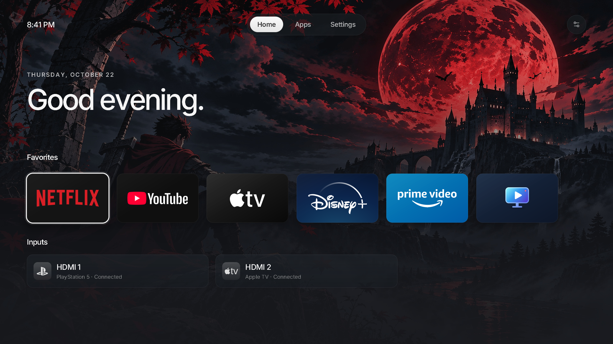
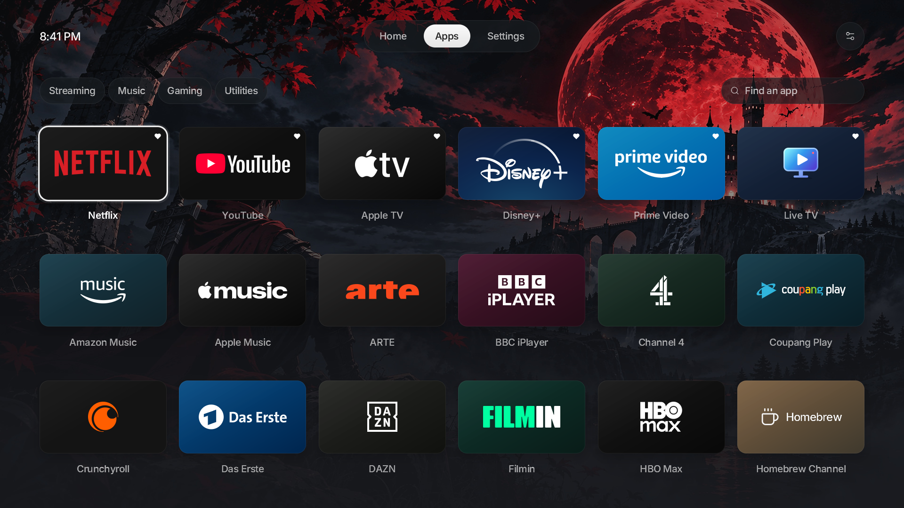
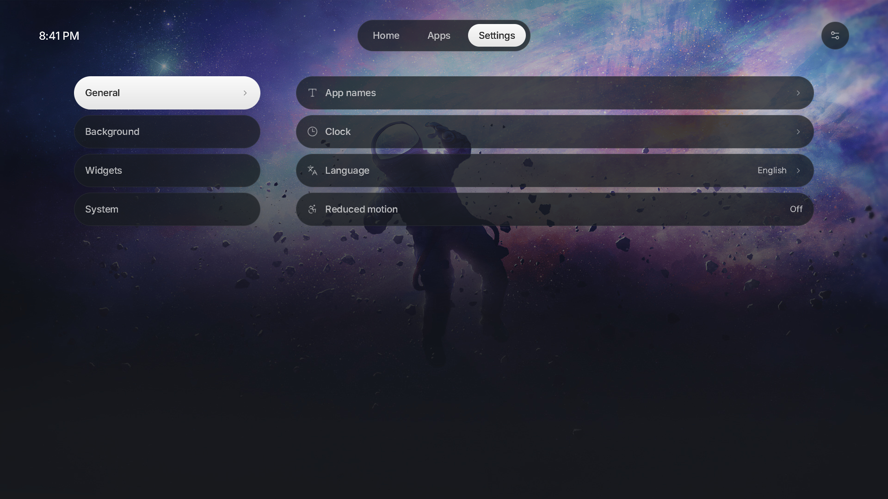
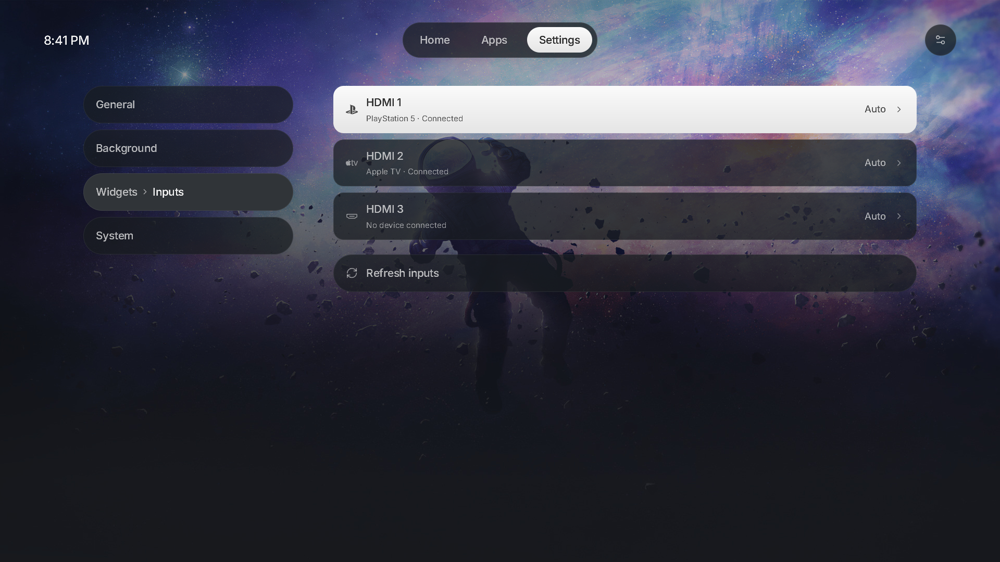

# Astro

A native launcher for rooted LG webOS TVs, inspired by Apple TV.

Based on [lg-luma](https://github.com/ecklf/lg-luma) by Florentin Eckl and the Luma contributors,
used under the MIT license (see [`license`](license)).

https://github.com/user-attachments/assets/2156d640-b8fa-4ea4-a02c-0db4c93bcc5a

<details>
<summary>Screenshots</summary>

<table>
  <tr>
    <td width="50%" align="center">
      
    </td>
    <td width="50%" align="center">
      
    </td>
  </tr>
  <tr>
    <td width="50%" align="center">
      
    </td>
    <td width="50%" align="center">
      
    </td>
  </tr>
</table>

</details>

## Compatibility

> [!NOTE]
> This is a personal build for one TV: an **LG 55NANO80ASA running webOS 25 (10.3.2-34)**. Code
> for other webOS versions and models was removed, so other TVs are not supported.

## Installation

### Homebrew Channel

```text
https://github.com/danielcanoh22/lg-astro/releases/latest/download/repo.json
```

### SSH

On your computer, replace `TV_IP`:

```sh
scp -O dist/com.danielcanoh22.astro_5.0.0_arm.ipk root@TV_IP:/tmp/astro.ipk
ssh root@TV_IP
```

In the TV's root shell:

```sh
luna-send -i luna://com.webos.appInstallService/dev/install \
  '{"id":"com.danielcanoh22.astro","ipkUrl":"/tmp/astro.ipk","subscribe":true}'
```

## Replacing LG Home

### Takeover Method

> [!NOTE]
> The takeover mounts Astro's Home app over LG's system Home app.\
> The takeover does not delete LG Home: it remains underneath a temporary mount, which is cleared by
> a reboot. If Astro is uninstalled first, LG Home returns on reboot, but the separate takeover boot
> hook remains and logs an error because it can no longer find Astro. No TV reset is needed. For
> clean removal, disable takeover before uninstalling.

Install Astro and verify that it opens normally. Disable any Home-button mapping in
[LG Input Hook](https://github.com/Simon34545/lginputhook) (remove its Home-key action) and any
other Home replacement, then run in the TV's root SSH shell:

To enable the takeover run:

```sh
APP=/media/developer/apps/usr/palm/applications/com.danielcanoh22.astro
sh "$APP/home.sh" enable
```

To see the status or disable the home override use:

```sh
sh /var/lib/astro-home/home.sh status
sh /var/lib/astro-home/home.sh disable
```

`restore` is an alias for `disable`.

If Astro fails to start as Home three times in a row, it gives LG Home back automatically so the TV
and remote stay usable. The takeover stays enabled: the next full reboot (not a Quick Start+ wake)
applies Astro again.

Boot log: `/var/lib/astro-home/boot.log`. See the
[development guide](development.md#optional-native-home-integration) for implementation details.

<details>
<summary>How the takeover works</summary>

Mounts Astro over the system Home app and reapplies the mount at cold boot. The LG splash
shown before Astro's window opens is the wallpaper you selected in **Settings → Background**, staged
from the saved preferences at each boot. Normal app launches also use your selected wallpaper:
Astro updates the launch splash through Homebrew Channel's root service after loading or saving your
settings. Open Astro once after installing or updating so subsequent launches use your saved background.
LG Home's original files remain underneath, using the same approach as
[Glasshouse Home](https://github.com/rorygallagher2024/glasshouse/blob/main/server/lib/home-takeover.js).

</details>

### LG Input Hook Method

You can use [LG Input Hook](https://repo.webosbrew.org/apps/org.webosbrew.inputhook/), configure an Execute action with this one-line command:

```sh
/usr/bin/luna-send -n 1 -w 5000 luna://com.webos.service.applicationmanager/launch '{"id":"com.danielcanoh22.astro"}'
```

Test on a spare button first. Disable the mapping in Input Hook to restore normal Home behavior.

### TV Input Method

Turn on **Settings → System → Show as TV input** to list Astro in LG's input picker. Astro runs
`astro-helper tv-input` through Homebrew Channel's root service; over SSH,
`/media/developer/apps/usr/palm/applications/com.danielcanoh22.astro/astro-helper tv-input enable` does the
same. The helper
verifies that LG actually lists Astro, and undoes registration if it does not. Use `status` to
inspect it or `disable` to remove it. This is separate from takeover and never changes Home Auto
Launch, HDMI selection, or the power-on preference automatically.

Select Astro from LG's input picker and use the TV's last-input startup option where available.
Registration alone does not prove startup support. With takeover on, pressing Home before the
takeover applies at cold boot still opens LG Home. Select HDMI or Live TV before removing the entry.
On the LG 55NANO80ASA (webOS 25), LG's input picker does not show the registered input, but opening
`com.danielcanoh22.astro` makes it the last input. Once registered, Astro lists an **Astro** card in its own
inputs row for that: select it before turning the TV off to power on into Astro.

With takeover on and the input registered, opening Home (the Home key, or Home starting in front)
also opens Astro's input copy, so pressing Home before turning the TV off is enough. A Home that
the TV starts behind another input or app, for example after powering on into Astro's input, leaves
the screen alone. When that copy is
already running the switch is seamless; when it has to start there is one short flicker. Both
copies share the same preferences: each reloads them when it comes back to the screen, and the
input copy reopens on its Home page with Recent apps closed. Home switches only when it is opened,
at most once every 5 seconds, and after three quick switches in a row it stops until you press
Home in Astro, so an input copy that keeps exiting does not keep reopening. The Astro card opens the
same full input copy.
Thanks to phranklins in [#79](https://github.com/ecklf/lg-luma/issues/79#issuecomment-6416333882)
and [Hearth](https://github.com/rudra-avatar/Hearth/blob/b9f0a1c8240303b7cd52fdc820e2f840ac6d3a0e/src/lib/tvinput.ts)
for the suggestion and API reference.

## Features

### Backgrounds

Open **Settings → Background → Upload**, then scan the QR code or open the shown
address on a phone or computer on the same network. Choose a JPEG, PNG or WebP and adjust
its 16:9 crop before choosing **Save to TV**. The TV then shows the image: choose **Save** to add
it to your backgrounds, or **Discard** (or Back) to delete it. Nothing joins the gallery until you
save it on the TV, and an image not saved before the dialog closes is deleted.

The upload link works only while its TV dialog is open and focused.

The background you choose, bundled or uploaded, is also the LG splash shown while Astro opens.
Deleting it leaves nothing behind: the splash moves to your current background.

Enable **Rotation** beside **Upload** to cycle through backgrounds on each Astro restart and every
15 minutes with a slow cross-fade. Rotation is off by default and leaves your manually chosen
LG splash unchanged.

Toggle **Gradient** beside **Rotation** to turn background shading on or off. It defaults to On
and remembers your choice. Older uploads without an unshaded copy keep their full-resolution
shaded image. This does not change LG's launch splash.

### Recent app switching

Press **Back** on Home, or hold **Back** for 0.6 seconds from any page, to open Recent apps.

- **Left / Right**, the pointer, or the scroll wheel browses recent apps and inputs.
- **OK** or a pointer click opens the selected app or input.
- **Up** closes the selected app and removes its card.
- **Back** dismisses the switcher and restores the previous page and focus.

These shortcuts work while Astro is focused. From another app, return to Astro first.

## Development

### Setup & Building

From the repository root, with Nix flakes enabled:

```sh
nix develop
pnpm install --frozen-lockfile
pnpm sdk
export WEBOS_NDK="$PWD/.build/toolchain/arm-webos-linux-gnueabi_sdk-buildroot"
pnpm run package
```

The first native runtime preparation also downloads a
checksum-pinned SDL-webOS library; both downloads are cached under `.build/`.

Output:

```text
dist/com.danielcanoh22.astro_5.0.0_arm.ipk
dist/sha256sums
dist/repo.json
dist/app-icon-large.png
```

Open [webOS Dev Manager](https://github.com/webosbrew/dev-manager-desktop), connect to the TV's
IP on port **22** as **root**, and install the IPK. Open **Astro** from the TV menu. Homebrew
Channel must be elevated.

The native package uses **`com.danielcanoh22.astro`**. Preferences and uploaded backgrounds are
stored in `/media/developer/com.danielcanoh22.astro`.

Wait for installation success; Ctrl+C closes an ongoing subscription. Fully close and reopen
Astro after updating. The [development guide](development.md#tv-startup-diagnostics) has a jailed
launch command that exposes errors hidden by the normal menu launch.

## Preview

```sh
nix develop
pnpm install --frozen-lockfile
pnpm assets
pnpm dev
```

The desktop preview uses sample inventory and never calls TV services. To manually exercise a
longer app grid:

```sh
pnpm dev --test-extra-apps 120
```

Preview preferences are separate from normal preferences. See [development.md](development.md)
for controls, vector rendering, diagnostics, tests and the source layout.

For release-worthy changes, include a file generated by `pnpm changeset` in your PR. The automated
Version Packages PR synchronizes app versions and publishes after merging and passing CI.
See [Releases](development.md#releases) for the workflow and repository setup.

## License

Astro is licensed under MIT.\
Astro is not affiliated with LG, Apple, or any other brands shown in its UI.
